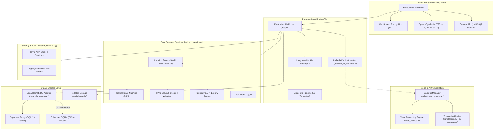
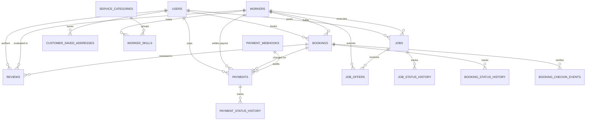

# 🎙️ VoiceHire — AI Voice-First Platform for India's Informal Workforce

<div align="center">


[](https://python.org)
[](https://flask.palletsprojects.com)
[](https://supabase.com)
[]()
[]()
[](LICENSE)

<p align="center">
  <strong>Bridging the digital divide for 450+ million informal workers across India through voice-native UX, 13 regional languages, location privacy shields, and cryptographic HMAC-SHA256 attendance verification.</strong>
</p>

[Explore Architecture](docs/ARCHITECTURE.md) • [View Database ERD](docs/ERD.md) • [API Documentation](docs/API.md) • [Getting Started](#-quick-start)

</div>

---

## 📖 Table of Contents

- [Overview & Mission](#-overview--mission)
- [The Challenge vs The VoiceHire Solution](#-the-challenge-vs-the-voicehire-solution)
- [Key Innovations & Features](#-key-innovations--features)
  - [1. Automatic Hindi Voice Prompt & Site-Wide Language Switch](#1-automatic-hindi-voice-prompt--site-wide-language-switch)
  - [2. Voice-First Profile Creation](#2-voice-first-profile-creation)
  - [3. Location Privacy Shield (Fuzzy Geofencing)](#3-location-privacy-shield-fuzzy-geofencing)
  - [4. Cryptographic HMAC-SHA256 QR Check-in](#4-cryptographic-hmac-sha256-qr-check-in)
  - [5. Escrow Payments & Dynamic Bharat UPI QR](#5-escrow-payments--dynamic-bharat-upi-qr)
  - [6. Zero-Config Hybrid Database (Supabase + Local SQLite)](#6-zero-config-hybrid-database-supabase--local-sqlite)
- [System Architecture](#-system-architecture)
- [Entity-Relationship Diagram (ERD)](#-entity-relationship-diagram-erd)
- [Supported Languages (13 Regional Dialects)](#-supported-languages-13-regional-dialects)
- [Technology Stack](#-technology-stack)
- [Repository Structure](#-repository-structure)
- [Quick Start & Installation](#-quick-start--installation)
- [Environment Configuration](#-environment-configuration)
- [Testing & Quality Assurance](#-testing--quality-assurance)
- [Security & DPDP Compliance](#-security--dpdp-compliance)
- [Documentation Index](#-documentation-index)

---

## 🎯 Overview & Mission

In India, over **450 million informal workers** — plumbers, electricians, carpenters, daily-wage laborers, painters, and domestic help — power the nation's informal economy. Despite their immense craftsmanship, they remain digitally invisible because traditional employment apps are built with complex English forms, dense text validation, and confusing authentication hoops.

**VoiceHire** fundamentally reimagines local hiring:
- **Zero Forms:** Workers speak in their mother tongue to build verified voice profiles.
- **Audio-First Landing:** When opening the website, the AI Assistant immediately welcomes the user out loud in **Hindi**, announces all available languages, and allows the visitor to switch the **entire platform** into their preferred regional tongue with a single tap or spoken command.
- **Privacy by Design:** Worker home addresses are masked using a differential ~500m fuzzy tile privacy shield.
- **Cryptographic Trust:** Job check-in and completion are verified using one-time HMAC-SHA256 signed QR codes and dynamic PINs.

---

## ⚖️ The Challenge vs The VoiceHire Solution

| The Informal Workforce Barrier | Traditional Hiring Platforms | The VoiceHire Innovation |
|---|---|---|
| **Language & Illiteracy** | Complex English forms, required typing | **100% Voice-First & Hindi Auto-Prompt** (Speaks 13 Indian languages) |
| **Worker Safety & Privacy** | Exact home GPS exposed to public | **Location Privacy Shield** (500m fuzzy snapping; exact GPS only during active booked jobs) |
| **Attendance Verification** | Unreliable verbal claims / paper slips | **HMAC-SHA256 Signed Dynamic QR** + 6-digit OTP verification |
| **Double-Booking & Conflicts** | Disorganized WhatsApp / Phone calls | **Atomic Double-Booking Prevention** (DB partial unique constraints) |
| **Payment Insecurity** | Disputed cash amounts & unpaid hours | **Razorpay & Bharat UPI QR Escrow** + Idempotency keys |
| **Offline / Low Connectivity** | App crashes without fast 5G data | **Offline Safe Drafts & Zero-Config SQLite Fallback** |

---

## ⭐ Key Innovations & Features

### 1. Automatic Hindi Voice Prompt & Site-Wide Language Switch
- **Instant Spoken Invitation:** As soon as a user visits VoiceHire, the AI assistant automatically opens and speaks in natural Hindi:
  > *"नमस्ते! VoiceHire में आपका स्वागत है। कृपया अपनी भाषा चुनें: हिंदी, अंग्रेज़ी, पंजाबी, मराठी, बंगाली, तमिल, तेलुगु, या गुजराती।"*
- **Browser Autoplay Protection:** Implements intelligent Web Audio unlock listeners (`click`, `touchstart`, `pointerdown`) alongside a floating *"🔊 आवाज़ सुनें (Tap to Listen)"* button to gracefully bypass aggressive browser autoplay blocks on mobile devices.
- **Whole Website Transformation:** Choosing a language updates server-side sessions and cookies, reloading the entire platform (headers, hero, feature cards, booking slots, dashboards, and footers) into the chosen tongue.

### 2. Voice-First Profile Creation
- Workers record short voice intros describing their trades, daily rates, and service localities.
- The voice engine automatically transcribes the audio into searchable text, extracts skills and trade metadata, and attaches introduction video reels.

### 3. Location Privacy Shield (Fuzzy Geofencing)
- Informal workers frequently face harassment or safety concerns when exact home coordinates are exposed publicly.
- VoiceHire’s `LocationPrivacyShield` automatically calculates an approximate ~500m geohash boundary (`approx_lat`, `approx_lng`) for public discovery. Exact coordinates are shared strictly between customer and worker once a booking is confirmed.

### 4. Cryptographic HMAC-SHA256 QR Check-in
- Tamper-proof, dynamic QR codes signed with server-side secrets (`hmac.compare_digest`).
- Enforces strict one-time consumption (`qr_token = NULL` upon scan) and verified geofence proximity tolerances (<= 1.0 km).
- Provides a dynamic 6-digit emergency PIN for workers on cameras with broken lenses.

### 5. Escrow Payments & Dynamic Bharat UPI QR
- Integration with Razorpay and native UPI deep links (Google Pay, PhonePe, Paytm, BHIM).
- Cryptographic idempotency keys prevent duplicate deductions on network retries.
- Worker payout settlement directly to configured UPI Virtual Payment Addresses (VPAs).

### 6. Zero-Config Hybrid Database (Supabase + Local SQLite)
- Seamless dual-mode database adapter (`local_db_adapter.py`).
- Operates out-of-the-box with cloud-hosted Supabase PostgreSQL or falls back to an embedded SQLite database for local offline development with zero setup.

---

## 🏗️ System Architecture



> 📖 **Read the in-depth specification in [docs/ARCHITECTURE.md](docs/ARCHITECTURE.md).**

---

## 🗄️ Entity-Relationship Diagram (ERD)

VoiceHire features **19 normalized relational tables** enforcing relational invariants, concurrency shields, and comprehensive audit trails:



### Core Schema Highlights:
- **`users`:** Customer identity, 10-digit Indian mobile validation, hashed passwords, localization preferences.
- **`workers`:** Trade, fuzzy privacy coordinates (`approx_lat`, `approx_lng`), real-time active job GPS, voice resumes, UPI VPAs, and ratings.
- **`bookings`:** Calendar slots with **partial unique index** (`uq_bookings_slot`) preventing double-booking race conditions.
- **`booking_checkin_events`:** Tamper-proof logs of QR scan arrivals, client coordinates, and status outcomes.
- **`payments`:** Full transaction lifecycle (`pending` ➔ `authorized` ➔ `captured` ➔ `completed`) with cryptographic idempotency keys.

> 📖 **Review complete column definitions, data types, and index constraints in [docs/ERD.md](docs/ERD.md).**

---

## 🇮🇳 Supported Languages (13 Regional Dialects)

VoiceHire is pre-configured with complete key parity and native formatting across **13 Indian languages**:

| Language | Code | Tier | Script | Voice Synthesis (TTS) | Speech Recognition (STT) |
|---|---|---|---|---|---|
| **Hindi** | `hi` | **Tier 1 (Default)** | Devanagari (हिंदी) | `hi-IN` Verified | Native Supported |
| **Punjabi** | `pa` | **Tier 1 Verified** | Gurmukhi (ਪੰਜਾਬੀ) | `pa-IN` Verified | Native Supported |
| **English** | `en` | **Tier 1 Verified** | Latin (Indian English) | `en-IN` Verified | Native Supported |
| **Bengali** | `bn` | **Tier 2 Regional** | Bengali (বাংলা) | `bn-IN` | Browser Fallback |
| **Marathi** | `mr` | **Tier 2 Regional** | Devanagari (मराठी) | `mr-IN` | Browser Fallback |
| **Tamil** | `ta` | **Tier 2 Regional** | Tamil (தமிழ்) | `ta-IN` | Browser Fallback |
| **Telugu** | `te` | **Tier 2 Regional** | Telugu (తెలుగు) | `te-IN` | Browser Fallback |
| **Gujarati** | `gu` | **Tier 2 Regional** | Gujarati (ગુજરાતી) | `gu-IN` | Browser Fallback |
| **Kannada** | `kn` | **Tier 2 Regional** | Kannada (ಕನ್ನಡ) | `kn-IN` | Browser Fallback |
| **Malayalam** | `ml` | **Tier 2 Regional** | Malayalam (മലയാളം) | `ml-IN` | Browser Fallback |
| **Odia** | `or` | **Tier 2 Regional** | Odia (ଓଡ଼ିଆ) | `or-IN` | Browser Fallback |
| **Urdu** | `ur` | **Tier 2 Regional** | Perso-Arabic (اردو) | `ur-IN` | Browser Fallback |
| **Assamese** | `as` | **Tier 2 Regional** | Assamese (অসমীয়া) | `as-IN` | Browser Fallback |

---

## 🛠️ Technology Stack

```
┌────────────────────────────────────────────────────────────────────────┐
│                          VOICEHIRE TECH STACK                          │
├─────────────────┬──────────────────────────────────────────────────────┤
│ Core Backend    │ Python 3.11+, Flask 3.0.3, Werkzeug, Jinja2 SSR      │
│ Database Layer  │ Supabase (PostgreSQL 15), SQLite3 Local Failover     │
│ Security & Auth │ Werkzeug Bcrypt, HMAC-SHA256, Secrets Token Generator │
│ Speech & Audio  │ Web Speech API (SpeechRecognition & SpeechSynthesis) │
│ Payments        │ Razorpay API, Bharat Dynamic UPI QR Deep-Links       │
│ Frontend UI     │ Modern Vanilla CSS3 (Custom Design System), HTML5    │
│ QR Engine       │ qrcode 7.4.2, Pillow Image Processing                │
│ Production Srv  │ Gunicorn WSGI Server                                 │
└─────────────────┴──────────────────────────────────────────────────────┘
```

---

## 📂 Repository Structure

```
voicehire/
├── app.py                      # Core Flask monolith entry point & route controllers
├── backend_service.py          # Domain logic (Privacy Shield, Booking Workflow, Payments)
├── auth_security.py            # Authentication shield, bcrypt hashing, token recovery
├── orchestration_engine.py     # Multi-turn conversation dialogue state machine
├── voice_service.py            # Audio processing, speech recognition & synthesis helper
├── translations.py             # Multilingual dictionary & Indian localization formatting
├── local_db_adapter.py         # Dual Supabase PostgreSQL / Local SQLite hybrid adapter
├── requirements.txt            # Python dependencies
├── docs/                       # Technical architecture & API references
│   ├── ARCHITECTURE.md         # Comprehensive system architecture & C4 breakdown
│   ├── ERD.md                  # Database Entity-Relationship Reference (19 Tables)
│   ├── API.md                  # Complete REST API endpoint reference
│   ├── REQUIREMENTS.md         # Finalized engineering requirements spec
│   └── BACKUP_AND_RECOVERY.md  # Production disaster recovery protocols
├── static/
│   ├── css/                    # Responsive mobile-first stylesheet & tokens
│   ├── js/
│   │   ├── gateway_ai_assistant.js # Unified persistent AI voice assistant shell
│   │   ├── voice_services.js       # Production Web Speech API audio layer
│   │   └── app.js                  # Global application script & offline banners
│   └── uploads/                # Isolated directory for audio, video, ids, and avatars
├── supabase/
│   └── schema.sql              # Authoritative PostgreSQL schema DDL
├── templates/                  # Server-side rendered Jinja2 templates
└── tests/                      # 253 comprehensive unit and integration tests
```

---

## 🚀 Quick Start & Installation

### Prerequisites
- **Python:** Version 3.11 or higher
- **Node.js:** Version 18+ *(optional, for running headless browser assistant tests)*
- **Git**

### 1. Clone the Repository
```bash
git clone https://github.com/your-username/voicehire.git
cd voicehire
```

### 2. Set Up Virtual Environment
```bash
# On Linux/macOS
python3 -m venv .venv
source .venv/bin/activate

# On Windows (PowerShell)
python -m venv .venv
.venv\Scripts\Activate.ps1
```

### 3. Install Dependencies
```bash
pip install -r requirements.txt
```

### 4. Configure Environment Variables
Copy `.env.example` to `.env`:
```bash
cp .env.example .env
```
*(The platform runs smoothly out of the box using the integrated local SQLite database adapter even without Supabase keys!)*

### 5. Launch Application
```bash
# Development mode
python app.py

# Production mode with Gunicorn
gunicorn -w 4 -b 0.0.0.0:5000 app:app
```
Open **[http://localhost:5000](http://localhost:5000)** in your browser. The AI Voice Assistant will greet you automatically in Hindi!

---

## ⚙️ Environment Configuration

| Variable | Required? | Default | Purpose |
|---|---|---|---|
| `SECRET_KEY` | **Yes** (Prod) | `super_secret_voicehire_key` | Signs session cookies & HMAC-SHA256 QR tokens |
| `APP_ENV` | No | `development` | Environment mode (`development`, `staging`, `production`) |
| `SUPABASE_URL` | Optional | `None` | Remote Supabase project URL *(uses local SQLite if absent)* |
| `SUPABASE_KEY` | Optional | `None` | Remote Supabase service / anon API key |
| `RAZORPAY_KEY_ID` | Optional | `None` | Razorpay payment gateway API public key |
| `RAZORPAY_KEY_SECRET` | Optional | `None` | Razorpay payment gateway secret |

---

## 🧪 Testing & Quality Assurance

VoiceHire enforces a strict **empirical verification protocol**. All modifications must pass rigorous unit and integration tests:

```bash
# Run the complete test suite (253 tests)
python -m unittest discover tests

# Run multilingual coverage verification (21 tests)
python -m unittest tests/test_language_coverage.py

# Run voice assistant and profile state machine tests
python -m unittest tests/test_phase14_1_assistant_and_profile.py

# Run client-side assistant browser automation tests (Node.js)
node tests/test_assistant_browser.js
```

**Test Suite Health:**
```
Ran 253 tests in 17.827s — OK (All tests passing)
Ran 21 language coverage tests in 0.092s — OK (100% dialect key parity)
Ran 6 headless assistant state machine tests — OK
```

---

## 🔒 Security & DPDP Compliance

- **Zero Voice Credential Harvesting:** Passwords, PINs, OTPs, and payment card details are strictly protected from voice parsing (`setupSensitiveInputProtection`).
- **One-Time HMAC-SHA256 Tokens:** Booking QR tokens are cryptographically signed and immediately destroyed upon check-in.
- **Timing-Safe Equality:** Secret and signature comparisons always utilize constant-time `hmac.compare_digest()`.
- **Indian DPDP Act (Digital Personal Data Protection):** Workers can download their entire history in one-click CSV exports, delete voice recordings, and immediately revoke live GPS tracking.

---

## 📚 Documentation Index

For in-depth architectural and developer documentation, refer to the `docs/` repository:

- 🏛️ **[docs/ARCHITECTURE.md](docs/ARCHITECTURE.md)** — In-depth architectural blueprint, C4 model, sequences, and security guarantees.
- 🗄️ **[docs/ERD.md](docs/ERD.md)** — Complete 19-table database schema, foreign key relations, and integrity invariants.
- 📡 **[docs/API.md](docs/API.md)** — Exhaustive REST API endpoint specifications with sample requests and response codes.
- 📋 **[docs/REQUIREMENTS.md](docs/REQUIREMENTS.md)** — Finalized engineering rules, constraints, and audit milestones.
- 🔄 **[docs/BACKUP_AND_RECOVERY.md](docs/BACKUP_AND_RECOVERY.md)** — Production database snapshotting and disaster recovery procedures.

---

<div align="center">
  <p><strong>VoiceHire</strong> — Crafted with ❤️ in India for the informal workforce.</p>
  <p>© 2026 VoiceHire Platform. Released under the <a href="LICENSE">MIT License</a>.</p>
</div>
