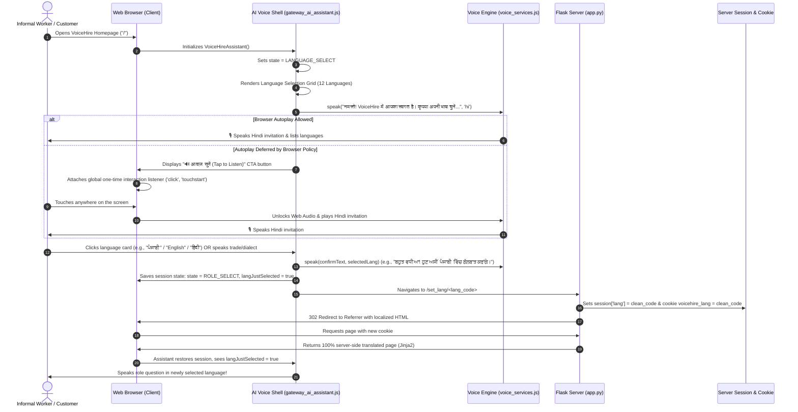
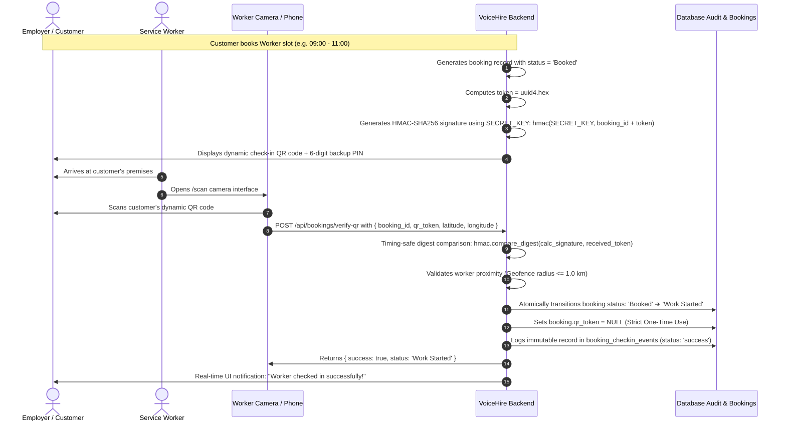
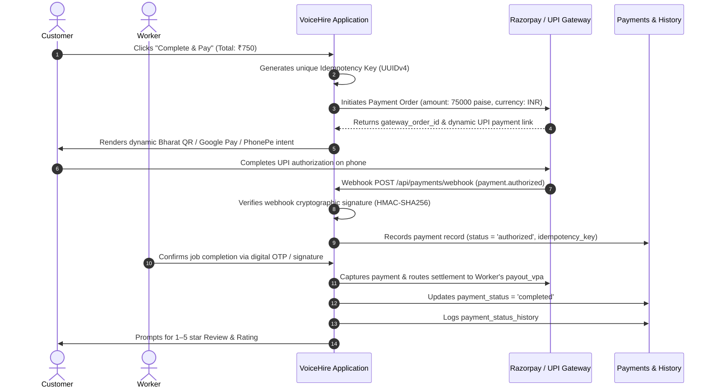

# ARCHITECTURE.md — VoiceHire System Architecture Reference

> **Document Type:** Comprehensive Technical Architecture Reference  
> **System:** VoiceHire Platform  
> **Version:** 2.0.0 (Production Architecture)  
> **Target Audience:** Software Engineers, System Architects, Security Auditors, and Technical Reviewers  

---

## 1. System Overview

**VoiceHire** is an AI-powered, voice-first dual-sided marketplace engineered specifically for India's 450+ million informal and daily-wage workforce (e.g., plumbers, electricians, carpenters, domestic helpers, painters).

Traditional employment platforms present insurmountable barriers for low-literacy informal workers due to complex multi-step text forms, English-dominated interfaces, and opaque rating mechanisms. VoiceHire eliminates these barriers through an **accessibility-first, voice-native paradigm**:

- **Workers** speak in their native tongue to create rich voice profiles, showcase skills via video, receive hyper-local job leads within a 2–10 km radius, and verify work attendance via tamper-proof QR codes.
- **Customers** discover verified, nearby service professionals, listen to genuine voice resumes, book structured calendar time slots, and make seamless digital payments.
- **Platform Guarantee:** Built-in cryptographic verification, location obfuscation protecting worker privacy, zero voice collection of credentials, and instantaneous 13-language translation.

```
                      ┌───────────────────────────────────────────────┐
                      │              VOICEHIRE PLATFORM               │
                      └──────────────────────┬────────────────────────┘
                                             │
               ┌─────────────────────────────┴─────────────────────────────┐
               ▼                                                           ▼
    ┌──────────────────────┐                                    ┌──────────────────────┐
    │   WORKER ECOSYSTEM   │                                    │  CUSTOMER ECOSYSTEM  │
    ├──────────────────────┤                                    ├──────────────────────┤
    │ • Hindi Voice Prompt │                                    │ • Smart Search & Map │
    │ • Speech-to-Profile  │                                    │ • Voice Resume Audio │
    │ • Video Showcase     │ ◄────────── MATCHING ────────────► │ • Slot Reservations  │
    │ • QR Check-in Scan   │            & SECURITY              │ • Dynamic UPI QR/Card│
    │ • UPI VPA Settlement │                                    │ • Ratings & Disputes │
    └──────────────────────┘                                    └──────────────────────┘
```

---

## 2. High-Level Architecture Topology

The application is structured as a resilient, modular monolith written in Python 3.11+ (Flask 3.0.3), backed by PostgreSQL (Supabase) with an intelligent zero-config local SQLite adapter fallback, coupled with server-side rendered Jinja2 templates and a unified client-side speech engine.

```mermaid
graph TB
    subgraph ClientLayer ["Client Layer (Accessibility First)"]
        BrowserMobile["Mobile Web Browser (Responsive PWA)"]
        BrowserDesktop["Desktop Web Browser"]
        WebSpeech["Web Speech API (STT & TTS Engine)"]
        CameraAPI["Camera API (HMAC QR Scanner)"]
        GeoAPI["Geolocation API (HTML5 Live GPS)"]
    end

    subgraph EdgeRouting ["Presentation & Gateway Tier"]
        FlaskRouter["Flask Application Router (app.py)"]
        LangInterceptor["Language & Cookie Interceptor (@app.before_request)"]
        ContextProcessor["Localization Context Processor (inject_translation)"]
        JinjaSSR["Jinja2 SSR Template Engine (16 Templates)"]
        UnifiedAssistant["Unified AI Voice Assistant Shell (gateway_ai_assistant.js)"]
    end

    subgraph EngineTier ["Orchestration & Voice Tier"]
        VoiceEngine["Voice Processing Service (voice_service.py)"]
        OrchestrationEngine["Multi-turn Orchestration Engine (orchestration_engine.py)"]
        LLMAdapter["LLM Extraction Adapter (llm_adapter.py)"]
        TransEngine["Multilingual Translation Engine (translations.py - 13 Indian Languages)"]
    end

    subgraph ServiceLayer ["Core Domain Services (backend_service.py)"]
        PrivacyShield["Location Privacy Shield (Fuzzy Snapping)"]
        WorkflowManager["Booking Workflow & State Machine"]
        CheckinSecurity["HMAC-SHA256 Booking Check-in Security"]
        PaymentService["Razorpay & UPI Escrow Payment Manager"]
        SafetyManager["Trust, Safety & Dispute Manager"]
        AuditService["Structured Audit & Event Logger"]
        NotificationMgr["In-App Notification Dispatcher"]
    end

    subgraph SecurityTier ["Auth & Security Tier (auth_security.py)"]
        AuthShield["Auth Shield (Bcrypt + Rate Limiter)"]
        RecoveryManager["Account Recovery & Security Tokens"]
        SessionStore["Server-Side Secure Cookie Sessions"]
    end

    subgraph DataTier ["Data & Persistence Tier"]
        DBAdapter["Local/Remote DB Adapter (local_db_adapter.py)"]
        SupabasePostgres["Supabase Managed PostgreSQL"]
        SQLiteLocal["Local SQLite Database (Development/Offline Fallback)"]
        LocalFS["Static File Storage (static/uploads/audio, video, ids, profile_pics)"]
    end

    BrowserMobile --> WebSpeech
    BrowserMobile --> CameraAPI
    BrowserMobile --> GeoAPI
    BrowserMobile --> FlaskRouter
    BrowserDesktop --> FlaskRouter

    FlaskRouter --> LangInterceptor
    LangInterceptor --> ContextProcessor
    ContextProcessor --> JinjaSSR
    FlaskRouter --> UnifiedAssistant

    FlaskRouter --> SecurityTier
    FlaskRouter --> EngineTier
    FlaskRouter --> ServiceLayer

    UnifiedAssistant -.->|WebSocket / AJAX Intent| EngineTier
    EngineTier --> VoiceEngine
    EngineTier --> OrchestrationEngine
    OrchestrationEngine --> LLMAdapter
    EngineTier --> TransEngine

    ServiceLayer --> PrivacyShield
    ServiceLayer --> WorkflowManager
    ServiceLayer --> CheckinSecurity
    ServiceLayer --> PaymentService
    ServiceLayer --> SafetyManager
    ServiceLayer --> AuditService
    ServiceLayer --> NotificationMgr

    ServiceLayer --> DBAdapter
    SecurityTier --> DBAdapter
    DBAdapter --> SupabasePostgres
    DBAdapter -.->|Failover / Offline| SQLiteLocal
    FlaskRouter --> LocalFS
```



---

## 3. Layer-by-Layer Architectural Breakdown

### 3.1 Presentation & SSR Layer (`templates/`, `static/`)
- **Server-Side Rendered (SSR):** Templates are rendered on the server via Flask Jinja2 to guarantee sub-second First Contentful Paint (FCP) on low-end budget smartphones across 3G/4G networks.
- **Unified Public Gateway (`templates/gateway.html`):** The primary landing portal featuring the automated Hindi voice onboarding greeting, dynamic language selector, trust proofs, and service category grids.
- **Client Voice Layer (`static/js/gateway_ai_assistant.js`, `static/js/voice_services.js`):**
  - Instantaneous Hindi auto-speech prompting on arrival.
  - Browser Autoplay Policy recovery mechanism: Automatically unlocks Web Audio via global first-interaction listeners (`click`, `touchstart`, `pointerdown`) and a fallback *"🔊 Tap to Listen"* button.
  - Hands-free auto-listening sequence with echo cancellation delay (300ms) after speech completion.
  - Safe client-side draft preservation (`localStorage`) with strict stripping of passwords and sensitive tokens.

### 3.2 Voice & AI Orchestration Tier
- **`voice_service.py`:** Handles speech capability introspection, language dialect mapping (e.g., `hi-IN`, `pa-IN`, `en-IN`), audio transcoding, and voice intent classification.
- **`orchestration_engine.py`:** A deterministic conversation state machine managing conversational transitions across onboarding, trade identification, location extraction, and job booking.
- **`translations.py`:** Platform-wide translation registry supporting **13 Indian languages**:
  - **Tier 1 Verified:** Hindi (`hi`), Punjabi (`pa`), English (`en`) with full voice & interface parity.
  - **Tier 2 Regional:** Bengali (`bn`), Marathi (`mr`), Tamil (`ta`), Telugu (`te`), Gujarati (`gu`), Kannada (`kn`), Malayalam (`ml`), Odia (`or`), Urdu (`ur`), Assamese (`as`).
  - **Indian Market Localization:** Native Indian rupee formatting with lakh/crore comma grouping (e.g., ₹1,50,000), Indian date formats, and humanized relative timestamps (e.g., "5 मिनट पहले").

### 3.3 Domain Services Layer (`backend_service.py`)
- **`LocationPrivacyShield`:** Implements differential location privacy. Worker coordinates are snapped to a coarse ~500m fuzzy grid for public directory browsing. Exact GPS coordinates are disclosed strictly between customer and worker upon an accepted, active booking.
- **`BookingWorkflowManager` & `VALID_BOOKING_TRANSITIONS`:** Strictly enforced finite state machine (`Pending` ➔ `Booked` ➔ `Work Started` ➔ `Completed` or `Cancelled`).
- **`BookingCheckinSecurity`:** Validates worker arrival through cryptographic HMAC-SHA256 signatures, dynamic 6-digit backup PINs, and geofence proximity tolerances.
- **`PaymentManager` & `RazorpayGatewayService`:** Handles UPI dynamic QR generation, authorization, captured status transitions, idempotency key verification, and worker payout VPA routing.
- **`TrustAndSafetyManager`:** Governs customer/worker ratings, dispute reporting, user blocking, and automated fraud flags.

### 3.4 Data Access & Resilience Layer (`local_db_adapter.py`)
- Provides a unified `SupabaseClient`-compatible interface.
- Automatically connects to remote Supabase PostgreSQL when credentials exist.
- When working offline, in test environments, or when network connectivity drops, seamlessly switches to an embedded SQLite datastore without requiring application code changes.

---

## 4. Entity-Relationship Diagram (ERD)

VoiceHire's relational database architecture encompasses 19 normalized entities designed for transactional integrity, auditability, and role separation.

```mermaid
erDiagram
    USERS ||--o{ BOOKINGS : "places as customer"
    USERS ||--o{ JOBS : "creates as poster"
    USERS ||--o{ REVIEWS : "writes"
    USERS ||--o{ CUSTOMER_SAVED_ADDRESSES : "saves"
    USERS ||--o{ PAYMENTS : "pays as customer"
    USERS ||--o{ NOTIFICATIONS : "receives"
    USERS ||--o{ JOB_REPORTS : "reports/reported"
    USERS ||--o{ BLOCKED_USERS : "blocks/blocked"

    WORKERS ||--o{ BOOKINGS : "assigned to"
    WORKERS ||--o{ JOBS : "accepts"
    WORKERS ||--o{ REVIEWS : "receives"
    WORKERS ||--o{ WORKER_SKILLS : "possesses"
    WORKERS ||--o{ JOB_OFFERS : "submits"
    WORKERS ||--o{ PAYMENTS : "receives payout"
    WORKERS ||--o{ NOTIFICATIONS : "receives"
    WORKERS ||--o{ JOB_REPORTS : "reports/reported"
    WORKERS ||--o{ BLOCKED_USERS : "blocks/blocked"

    SERVICE_CATEGORIES ||--o{ WORKER_SKILLS : "categorizes"

    JOBS ||--o{ JOB_OFFERS : "receives"
    JOBS ||--o{ REVIEWS : "reviewed in"
    JOBS ||--o{ JOB_STATUS_HISTORY : "tracks status"
    JOBS ||--o{ PAYMENTS : "settles"
    JOBS ||--o{ JOB_REPORTS : "disputed in"

    BOOKINGS ||--o{ BOOKING_STATUS_HISTORY : "tracks status"
    BOOKINGS ||--o{ BOOKING_CHECKIN_EVENTS : "records attendance"
    BOOKINGS ||--o{ PAYMENTS : "settles"
    BOOKINGS ||--o{ REVIEWS : "reviewed in"
    BOOKINGS ||--o{ JOB_REPORTS : "disputed in"

    PAYMENTS ||--o{ PAYMENT_STATUS_HISTORY : "tracks state"
    PAYMENT_WEBHOOKS ||--o{ PAYMENTS : "verifies"

    USERS {
        uuid id PK
        string name
        string phone UK
        string password "Bcrypt hash"
        string profile_pic
        string locality
        string language_preference "hi, pa, en, etc."
        jsonb voice_settings
        boolean is_active
        timestamp created_at
        timestamp updated_at
    }

    WORKERS {
        uuid id PK
        string name
        string work "Primary Trade"
        string location
        string phone UK
        string password "Bcrypt hash"
        string voice_note
        string video
        string id_proof_path
        string profile_pic
        string voice_resume
        float latitude
        float longitude
        float approx_lat "Fuzzy 500m privacy grid"
        float approx_lng
        float live_lat "Real-time active job GPS"
        float live_lng
        boolean is_sharing_location
        boolean is_available
        boolean is_verified
        numeric price "Daily or service rate"
        string payout_vpa "UPI VPA"
        string verification_status "unsubmitted, verified"
        numeric avg_rating
        int review_count
        timestamp created_at
    }

    JOBS {
        bigint id PK
        uuid user_id FK
        uuid worker_id FK
        string service_type
        string description
        string location
        boolean is_urgent
        string status "open, accepted, completed, cancelled"
        numeric price
        string completion_token "Cryptographic URL-safe token"
        timestamp token_expires_at
        timestamp created_at
    }

    BOOKINGS {
        bigint id PK
        uuid customer_id FK
        uuid worker_id FK
        date date
        string time_slot "09:00-11:00, etc."
        string notes
        string status "Pending, Booked, Work Started, Completed, Cancelled"
        numeric total_price
        string qr_token "HMAC-SHA256 signature token"
        timestamp created_at
        timestamp updated_at
    }

    BOOKING_CHECKIN_EVENTS {
        bigint id PK
        bigint booking_id FK
        uuid worker_id FK
        uuid customer_id FK
        string event_type "checkin_attempt, checkin_verified"
        string status "success, failed, expired, tampered"
        string token_hash
        float client_lat
        float client_lng
        string failure_reason
        timestamp created_at
    }

    PAYMENTS {
        bigint id PK
        bigint booking_id FK
        bigint job_id FK
        uuid payer_id FK
        uuid payee_id FK
        numeric amount
        string currency "INR"
        string payment_method "cash, upi, qr, razorpay"
        string payment_status "pending, authorized, completed"
        string idempotency_key UK
        string transaction_ref
        string gateway_order_id
        string gateway_payment_id
        timestamp created_at
    }

    REVIEWS {
        bigint id PK
        bigint job_id FK
        bigint booking_id FK
        uuid worker_id FK
        uuid user_id FK
        int rating "1-5 stars"
        text review
        timestamp created_at
    }

    SERVICE_CATEGORIES {
        bigint id PK
        string name UK
        string slug UK
        string icon
        boolean is_active
        timestamp created_at
    }

    WORKER_SKILLS {
        bigint id PK
        uuid worker_id FK
        bigint category_id FK
        string skill_name
        int experience_years
        boolean is_primary
    }

    JOB_OFFERS {
        bigint id PK
        bigint job_id FK
        uuid worker_id FK
        numeric proposed_price
        int estimated_arrival_minutes
        string status "pending, accepted, rejected"
        timestamp created_at
    }

    BOOKING_STATUS_HISTORY {
        bigint id PK
        bigint booking_id FK
        string from_status
        string to_status
        uuid changed_by
        string changed_by_role
        string reason
        timestamp created_at
    }

    JOB_STATUS_HISTORY {
        bigint id PK
        bigint job_id FK
        string from_status
        string to_status
        uuid changed_by
        string reason
        timestamp created_at
    }

    PAYMENT_STATUS_HISTORY {
        bigint id PK
        bigint payment_id FK
        string from_status
        string to_status
        uuid changed_by
        timestamp created_at
    }

    PAYMENT_WEBHOOKS {
        bigint id PK
        string event_id UK
        string event_type
        jsonb payload
        string status
        timestamp created_at
    }

    NOTIFICATIONS {
        bigint id PK
        uuid recipient_id
        string recipient_role
        string title
        string message
        string type
        boolean is_read
        string idempotency_key UK
        timestamp created_at
    }

    CUSTOMER_SAVED_ADDRESSES {
        bigint id PK
        uuid user_id FK
        string label "Home, Work, Other"
        string street_address
        string locality
        string city
        string pincode
        boolean is_default
    }

    JOB_REPORTS {
        bigint id PK
        uuid reporter_id
        uuid reported_id
        bigint job_id FK
        bigint booking_id FK
        string reason
        string description
        string status "open, resolved"
        timestamp created_at
    }

    AUDIT_EVENTS {
        bigint id PK
        uuid actor_id
        string actor_role
        string event_type
        string resource_type
        string resource_id
        string action
        string status
        jsonb metadata
        timestamp created_at
    }

    BLOCKED_USERS {
        bigint id PK
        uuid blocker_id
        string blocker_role
        uuid blocked_id
        string blocked_role
        string reason
        timestamp created_at
    }
```



---

## 5. Critical Data Flows & Sequences

### 5.1 Automatic Hindi Voice Language Onboarding & Site Language Switch

When a user visits the platform, the system immediately asks for language preference in spoken Hindi, announces supported dialects, and upon selection, instantly switches the entire platform into the chosen language.



---

### 5.2 Cryptographic HMAC-SHA256 QR Check-in & Arrival Verification



---

### 5.3 Payment Escrow, Settlement & Dynamic UPI QR



---

## 6. Security, Compliance & Trust Architecture

| Safeguard | Implementation Mechanism | Threat Mitigated |
|-----------|--------------------------|------------------|
| **Location Privacy Shield** | Differential privacy via `approx_lat`/`approx_lng` snapping to ~500m geohash tiles. Exact GPS only exposed during live in-progress bookings. | Worker stalking, unauthorized home tracking, physical security risks. |
| **Zero Voice Credential Rule** | Assistant state machine strictly prohibits parsing passwords, PINs, OTPs, or CVVs via voice STT (`setupSensitiveInputProtection`). | Eavesdropping, accidental audio transcription leakage, credential theft. |
| **Cryptographic QR Tokens** | HMAC-SHA256 signature tokens verified with constant-time `hmac.compare_digest()`. Immediate one-time NULL invalidation upon consumption. | QR spoofing, attendance fraud, replay attacks. |
| **Double-Booking Shield** | PostgreSQL partial unique index: `uq_bookings_slot ON bookings (worker_id, date, time_slot) WHERE status != 'Cancelled'`. | Race conditions, conflicting time slot assignments. |
| **Idempotent Payment Engine** | Cryptographic idempotency keys on every transaction and notification dispatch. | Duplicate customer charges on network retries or double clicks. |
| **Brute-Force & Recovery Guard** | Flask session rate limiters, bcrypt key derivation with salted hashing, one-time cryptographically random recovery tokens (`secrets.token_urlsafe(32)`). | Credential stuffing, dictionary attacks, brute-force password cracking. |
| **Indian DPDP Act Compliance** | Privacy-by-design: workers retain right to download complete personal data as CSV, delete voice notes, and revoke location sharing at any time. | Regulatory non-compliance, unauthorized data hoarding. |

---

## 7. Storage Architecture

Uploaded media files (audio voice notes, introduction videos, ID proofs, and profile photos) are organized with strict isolation:

```
static/uploads/
├── audio/          # Voice notes & audio resumes (.mp3, .wav, .ogg, .m4a, .aac)
├── video/          # Profile intro videos (.mp4, .webm, .ogg, .mov)
├── ids/            # Government verification documents (.jpg, .jpeg, .png)
└── profile_pics/   # User and worker profile avatars (.jpg, .jpeg, .png)
```

**Security Rules for File Ingestion:**
1. **Extension Whitelisting:** Strict check via `allowed_file(filename, ALLOWED_SET)`.
2. **UUID Prefixing:** All filenames are cryptographically randomized with `uuid.uuid4().hex + '_' + secure_filename(filename)`.
3. **Payload Cap:** Enforced at the application gateway level: `MAX_CONTENT_LENGTH = 16 * 1024 * 1024` (16 MB).
4. **Direct Execution Shield:** Upload directories are non-executable; served strictly as static assets with appropriate MIME types.

---

## 8. Resilience, Testing & Verification Matrix

VoiceHire enforces empirical proof across all platform features. The codebase is tested across Python, JavaScript, and Node.js environments:

- **253 Full System Unit & Integration Tests:** Validating auth security, multi-turn dialogue orchestration, booking race conditions, payment transitions, and offline SQLite fallbacks.
- **21 Multilingual Parity Tests:** Guaranteeing 100% dictionary completeness across all supported regional dialects.
- **Browser Assistant Automations:** End-to-end verification of state persistence across page transitions, automated audio recovery, and profile completion.

---

*VoiceHire Architecture Reference — Authored for scalability, resilience, and maximum accessibility across India.*
