# ERD.md — VoiceHire Database Entity-Relationship Reference

> **Document Type:** Database Schema & Entity-Relationship Architecture  
> **Database Engine:** PostgreSQL (Supabase) with SQLite Zero-Config Local Adapter  
> **Schema Version:** 1.2.0 (19 Relational Entities)  
> **Target Audience:** Database Engineers, Backend Developers, and Data Analysts  

---

## 1. Visual Entity-Relationship Diagram

```mermaid
erDiagram
    USERS ||--o{ BOOKINGS : "places as customer"
    USERS ||--o{ JOBS : "creates as poster"
    USERS ||--o{ REVIEWS : "writes"
    USERS ||--o{ CUSTOMER_SAVED_ADDRESSES : "saves"
    USERS ||--o{ PAYMENTS : "pays as customer"
    USERS ||--o{ NOTIFICATIONS : "receives"
    USERS ||--o{ JOB_REPORTS : "reports/reported"
    USERS ||--o{ BLOCKED_USERS : "blocks/blocked"

    WORKERS ||--o{ BOOKINGS : "assigned to"
    WORKERS ||--o{ JOBS : "accepts"
    WORKERS ||--o{ REVIEWS : "receives"
    WORKERS ||--o{ WORKER_SKILLS : "possesses"
    WORKERS ||--o{ JOB_OFFERS : "submits"
    WORKERS ||--o{ PAYMENTS : "receives payout"
    WORKERS ||--o{ NOTIFICATIONS : "receives"
    WORKERS ||--o{ JOB_REPORTS : "reports/reported"
    WORKERS ||--o{ BLOCKED_USERS : "blocks/blocked"

    SERVICE_CATEGORIES ||--o{ WORKER_SKILLS : "categorizes"

    JOBS ||--o{ JOB_OFFERS : "receives"
    JOBS ||--o{ REVIEWS : "reviewed in"
    JOBS ||--o{ JOB_STATUS_HISTORY : "tracks status"
    JOBS ||--o{ PAYMENTS : "settles"
    JOBS ||--o{ JOB_REPORTS : "disputed in"

    BOOKINGS ||--o{ BOOKING_STATUS_HISTORY : "tracks status"
    BOOKINGS ||--o{ BOOKING_CHECKIN_EVENTS : "records attendance"
    BOOKINGS ||--o{ PAYMENTS : "settles"
    BOOKINGS ||--o{ REVIEWS : "reviewed in"
    BOOKINGS ||--o{ JOB_REPORTS : "disputed in"

    PAYMENTS ||--o{ PAYMENT_STATUS_HISTORY : "tracks state"
    PAYMENT_WEBHOOKS ||--o{ PAYMENTS : "verifies"

    USERS {
        uuid id PK "gen_random_uuid()"
        text name "Customer full name"
        text phone UK "10-digit Indian phone [6-9]d9"
        text password "Werkzeug Bcrypt hash"
        text profile_pic "Relative uploads path"
        text locality "City / service area"
        text language_preference "hi, pa, en, mr, etc."
        jsonb voice_settings "Auto-speak, voice, speed"
        boolean is_active "Soft deletion flag"
        timestamptz created_at
        timestamptz updated_at
    }

    WORKERS {
        uuid id PK "gen_random_uuid()"
        text name "Worker display name"
        text work "Primary trade (Plumber, etc.)"
        text location "Area / locality name"
        text phone UK "10-digit Indian phone"
        text password "Werkzeug Bcrypt hash"
        text voice_note "Relative path in static/uploads/audio"
        text video "Relative path in static/uploads/video"
        text id_proof_path "Relative path in static/uploads/ids"
        text profile_pic "Relative path in static/uploads/profile_pics"
        text voice_resume "Transcribed voice bio"
        float latitude "Exact registration latitude"
        float longitude "Exact registration longitude"
        float approx_lat "Snapping 500m fuzzy tile for privacy"
        float approx_lng "Snapping 500m fuzzy tile for privacy"
        float live_lat "Live GPS for active accepted job"
        float live_lng "Live GPS for active accepted job"
        boolean is_sharing_location "Real-time toggle"
        boolean is_available "Accepting work"
        boolean is_verified "Government ID verified"
        numeric price "Default day or service rate (INR)"
        text payout_vpa "Worker UPI VPA for settlement"
        text payout_status "unconfigured, pending, active"
        text verification_status "unsubmitted, pending, verified, rejected"
        numeric avg_rating "Derived 1.00 - 5.00"
        int review_count "Total verified ratings"
        timestamptz created_at
        timestamptz updated_at
    }

    JOBS {
        bigint id PK "Identity sequence"
        uuid user_id FK "Customer creator (users.id)"
        uuid worker_id FK "Assigned worker (workers.id)"
        text service_type "Required skill / trade"
        text description "Voice transcribed task details"
        text location "Job locality"
        boolean is_urgent "Urgent dispatch flag"
        text status "open, accepted, completed, cancelled"
        numeric price "Agreed job rate (INR)"
        text completion_token "One-time cryptographically random token"
        timestamptz token_expires_at "Token TTL"
        timestamptz created_at
    }

    BOOKINGS {
        bigint id PK "Identity sequence"
        uuid customer_id FK "users.id"
        uuid worker_id FK "workers.id"
        date date "Scheduled appointment date"
        text time_slot "09:00-11:00, 11:00-13:00, etc."
        text notes "Customer booking notes"
        text status "Pending, Booked, Work Started, Completed, Cancelled"
        numeric total_price "Total job charge (INR)"
        text qr_token "HMAC-SHA256 arrival token"
        timestamptz created_at
        timestamptz updated_at
    }

    BOOKING_CHECKIN_EVENTS {
        bigint id PK "Identity sequence"
        bigint booking_id FK "bookings.id"
        uuid worker_id FK "workers.id"
        uuid customer_id FK "users.id"
        text event_type "checkin_attempt, checkin_verified"
        text status "success, failed, expired, tampered"
        text token_hash "SHA256 digest of token"
        float client_lat "Scan GPS latitude"
        float client_lng "Scan GPS longitude"
        text failure_reason "Geofence out of bounds, etc."
        timestamptz created_at
    }

    PAYMENTS {
        bigint id PK "Identity sequence"
        bigint booking_id FK "bookings.id"
        bigint job_id FK "jobs.id"
        uuid payer_id FK "users.id"
        uuid payee_id FK "workers.id"
        numeric amount "Transaction value in INR"
        text currency "INR"
        text payment_method "cash, upi, qr, wallet, card"
        text payment_status "pending, authorized, captured, completed, failed"
        text idempotency_key UK "Client transaction UUID"
        text transaction_ref "UPI RRN or bank reference"
        text gateway_order_id "Razorpay order_id"
        text gateway_payment_id "Razorpay pay_id"
        timestamptz created_at
        timestamptz updated_at
    }

    REVIEWS {
        bigint id PK "Identity sequence"
        bigint job_id FK "jobs.id"
        bigint booking_id FK "bookings.id"
        uuid worker_id FK "workers.id"
        uuid user_id FK "users.id"
        int rating "1 to 5 integer"
        text review "Customer feedback comment"
        timestamptz created_at
    }

    SERVICE_CATEGORIES {
        bigint id PK "Identity sequence"
        text name UK "Category name"
        text slug UK "URL-friendly slug"
        text description "Trade overview"
        text icon "FontAwesome icon class"
        boolean is_active "Display flag"
        timestamptz created_at
    }

    WORKER_SKILLS {
        bigint id PK "Identity sequence"
        uuid worker_id FK "workers.id"
        bigint category_id FK "service_categories.id"
        text skill_name "Specific trade or skill"
        int experience_years "Years in practice"
        boolean is_primary "Worker's primary specialty"
    }

    JOB_OFFERS {
        bigint id PK "Identity sequence"
        bigint job_id FK "jobs.id"
        uuid worker_id FK "workers.id"
        numeric proposed_price "Worker bid in INR"
        int estimated_arrival_minutes "ETA"
        text status "pending, accepted, rejected"
        timestamptz created_at
    }

    BOOKING_STATUS_HISTORY {
        bigint id PK "Identity sequence"
        bigint booking_id FK "bookings.id"
        text from_status "Previous status"
        text to_status "New status"
        uuid changed_by "Actor UUID"
        text changed_by_role "user, worker, system, admin"
        text reason "Audit transition reason"
        timestamptz created_at
    }

    JOB_STATUS_HISTORY {
        bigint id PK "Identity sequence"
        bigint job_id FK "jobs.id"
        text from_status "Previous status"
        text to_status "New status"
        uuid changed_by "Actor UUID"
        text changed_by_role "user, worker, system"
        text reason "Audit transition reason"
        timestamptz created_at
    }

    PAYMENT_STATUS_HISTORY {
        bigint id PK "Identity sequence"
        bigint payment_id FK "payments.id"
        text from_status "Previous state"
        text to_status "New state"
        uuid changed_by "Actor UUID"
        timestamptz created_at
    }

    PAYMENT_WEBHOOKS {
        bigint id PK "Identity sequence"
        text event_id UK "Gateway webhook event_id"
        text event_type "payment.captured, etc."
        jsonb payload "Raw webhook payload"
        text status "processed, failed"
        timestamptz created_at
    }

    NOTIFICATIONS {
        bigint id PK "Identity sequence"
        uuid recipient_id "Recipient entity UUID"
        text recipient_role "user, worker, admin"
        text title "Notification header"
        text message "Body text in user language"
        text type "job_alert, booking_status, payment"
        boolean is_read "Read receipt"
        text idempotency_key UK "Deduplication key"
        timestamptz created_at
    }

    CUSTOMER_SAVED_ADDRESSES {
        bigint id PK "Identity sequence"
        uuid user_id FK "users.id"
        text label "Home, Shop, Site"
        text street_address "Address line"
        text locality "Area name"
        text city "City / Metro"
        text pincode "6-digit Indian PIN code"
        boolean is_default "Default selection"
    }

    JOB_REPORTS {
        bigint id PK "Identity sequence"
        uuid reporter_id "Reporting party"
        text reporter_role "user or worker"
        uuid reported_id "Target party"
        text reported_role "user or worker"
        bigint job_id FK "jobs.id"
        bigint booking_id FK "bookings.id"
        text reason "Dispute categorization"
        text description "Factual claim summary"
        text status "open, under_review, resolved, dismissed"
        timestamptz created_at
    }

    AUDIT_EVENTS {
        bigint id PK "Identity sequence"
        uuid actor_id "Acting UUID"
        text actor_role "Role of actor"
        text event_type "auth, checkin, payment"
        text resource_type "Entity modified"
        text resource_id "ID of entity"
        text action "create, update, delete"
        text status "success or failure"
        jsonb metadata "Structured audit context"
        timestamptz created_at
    }

    BLOCKED_USERS {
        bigint id PK "Identity sequence"
        uuid blocker_id "Initiating user UUID"
        text blocker_role "user or worker"
        uuid blocked_id "Blocked entity UUID"
        text blocked_role "user or worker"
        text reason "Safety / harassment reason"
        timestamptz created_at
    }
```



---

## 2. Relational Invariants & Integrity Constraints

1. **Anti-Double Booking Invariant:**
   ```sql
   CREATE UNIQUE INDEX uq_bookings_slot
     ON bookings (worker_id, date, time_slot)
     WHERE status != 'Cancelled';
   ```
   *Guarantees a worker can never be scheduled concurrently for the same date and time slot.*

2. **Single Accepted Offer Invariant:**
   ```sql
   CREATE UNIQUE INDEX uq_job_offers_accepted
     ON job_offers (job_id)
     WHERE status = 'accepted';
   ```
   *Guarantees an on-demand job cannot have more than one winning worker bid.*

3. **Single Review Invariant:**
   ```sql
   CREATE UNIQUE INDEX uq_reviews_booking ON reviews (booking_id) WHERE booking_id IS NOT NULL;
   CREATE UNIQUE INDEX uq_reviews_job ON reviews (job_id) WHERE job_id IS NOT NULL;
   ```
   *Prevents rating brigading and ensures exactly one review per fulfilled engagement.*

4. **Cryptographic Check-in Token Consumption:**
   When `verify_booking_qr()` succeeds:
   ```sql
   UPDATE bookings SET status = 'Work Started', qr_token = NULL, updated_at = now() WHERE id = :booking_id;
   ```
   *Tokens are one-time-use; invalidated immediately upon initial verification.*

---

*VoiceHire Database Architecture — Engineered for zero race conditions, complete auditability, and absolute worker privacy.*
